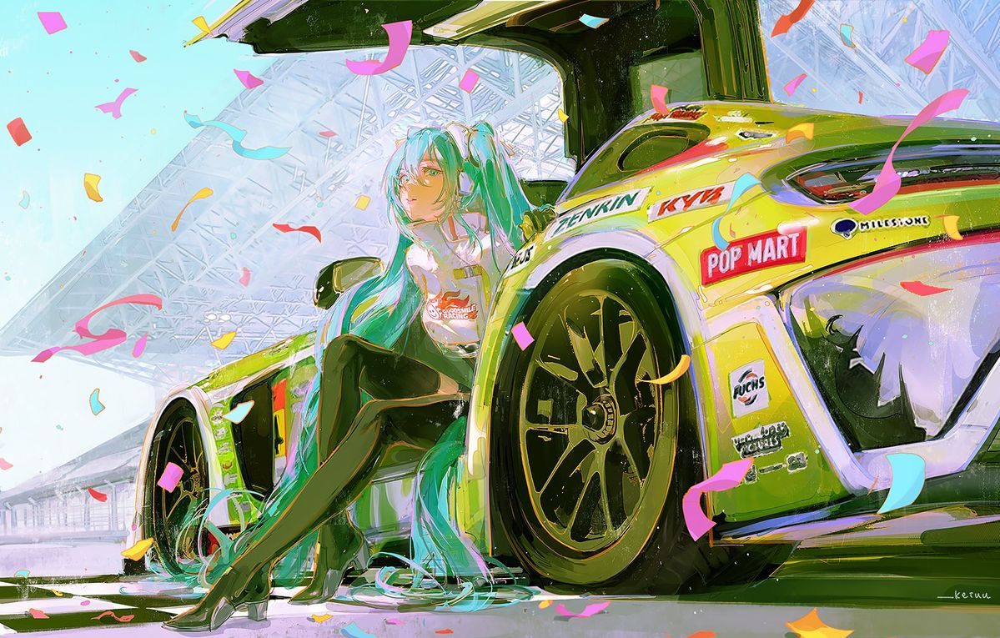

<div align="center">

# Discord Custom Background

**Use an image, GIF or video as your Discord background, with matching panel opacity and a built-in file library.**

[](https://github.com/gamehunt7062/discord-custom-background)
[](LICENSE)
[](#ways-to-use-it)
[](https://github.com/gamehunt7062/discord-custom-background/stargazers)

[Install](#installation) · [Features](#features) · [How to use](#using-the-panel) · [Troubleshooting](#troubleshooting) · [Contributing](#contributing)

</div>

<!--
Add a screenshot or GIF here after you publish:
<p align="center"></p>
-->

---

## Table of contents

- [Overview](#overview)
- [Features](#features)
- [Ways to use it](#ways-to-use-it)
- [Installation](#installation)
  - [Method 1: Web browser with a userscript manager (recommended)](#method-1-web-browser-with-a-userscript-manager-recommended)
  - [Method 2: Discord desktop app (Stable)](#method-2-discord-desktop-app-stable)
  - [Method 3: Browser console without an extension](#method-3-browser-console-without-an-extension)
- [Quick start](#quick-start)
- [Using the panel](#using-the-panel)
- [Keyboard shortcuts](#keyboard-shortcuts)
- [How uniform opacity works](#how-uniform-opacity-works)
- [Performance tips](#performance-tips)
- [Supported files](#supported-files)
- [Privacy and data storage](#privacy-and-data-storage)
- [Troubleshooting](#troubleshooting)
- [Updating](#updating)
- [Uninstalling](#uninstalling)
- [Development](#development)
- [Contributing](#contributing)
- [Disclaimer](#disclaimer)
- [License](#license)

---

## Overview

Discord Custom Background is a single-file userscript. It places your own image, GIF or video behind the Discord interface.

Discord paints each panel with its own semi-transparent colour, and these layers stack on top of each other. Because of this, the server list, channel list, chat and member list usually look different when you add a background. This project removes the panel colours and adds one shared overlay, so **all panels have the same opacity**.

The script has no dependencies. It makes no network requests. All of your files stay in your own browser or desktop app.

## Features

| Area | What you get |
| --- | --- |
| **Media** | Image, GIF and video backgrounds (`png`, `jpg`, `webp`, `gif`, `mp4`, `webm`) |
| **Uniform opacity** | Server list, channel list, chat and member list or profile panel all share the same darkness |
| **Library** | Every file is saved locally with a thumbnail. You can switch, rename or delete files at any time |
| **Drag and drop** | Drop a file on the panel, or hold <kbd>Shift</kbd> while dragging a file anywhere over Discord |
| **Zoom and rotation** | Zoom from 1× to 3×, rotate from 0° to 359°. Settings are remembered for each file |
| **Appearance** | Overlay darkness, image dim and image blur sliders |
| **Performance** | Freeze animation option, and video pauses automatically when the tab is hidden |
| **Themes** | Works with both the dark and the light Discord theme |
| **Privacy** | No tracking, no analytics and no network requests |

## Ways to use it

Choose the method that fits how you use Discord.

| Method | Where it works | What you need | Starts automatically | Best for |
| --- | --- | --- | :---: | --- |
| [**1. Browser and userscript manager**](#method-1-web-browser-with-a-userscript-manager-recommended) | Discord in a web browser | A userscript manager extension | Yes | Most users (recommended) |
| [**2. Discord desktop app (Stable)**](#method-2-discord-desktop-app-stable) | Official Discord desktop app | Edit one line in a settings file, then paste the script | No, repeat after each restart | People who prefer the desktop app |
| [**3. Browser console**](#method-3-browser-console-without-an-extension) | Discord in a web browser | Nothing to install | No, repeat after each reload | A quick test |

> [!NOTE]
> The Discord mobile apps (iOS and Android) are **not supported**.

---

## Installation

### Method 1: Web browser with a userscript manager (recommended)

This is the easiest and most reliable method. After the first setup, the background loads by itself every time you open Discord.

1. **Install a userscript manager** in your browser:
   - [Tampermonkey](https://www.tampermonkey.net/): Chrome, Edge, Firefox, Opera, Safari
   - [Violentmonkey](https://violentmonkey.github.io/): Chrome, Edge, Firefox
2. **Install the script.** Click the link below. Your userscript manager will open an install page. Press **Install**.

   **[Install Discord Custom Background](https://raw.githubusercontent.com/gamehunt7062/discord-custom-background/main/discord-custom-background.user.js)**

3. **Open Discord in your browser**: [discord.com/app](https://discord.com/app). If it was already open, reload the page.
4. Look for the round button in the bottom-right corner. This is the control panel.

The script also works on `ptb.discord.com` and `canary.discord.com`.

**Why is a userscript manager needed?** The script itself has no dependencies and downloads nothing. However, a browser does not run `.user.js` files on its own. The userscript manager is a small extension that loads the script on discord.com each time the page opens. It also delivers updates automatically.

### Method 2: Discord desktop app (Stable)

The official Discord desktop app is not a normal browser, so it cannot use a userscript manager. You can still run this script inside it by turning on Discord's built-in developer tools and pasting the script into the console.

> [!IMPORTANT]
> You must repeat **steps 5 to 7** every time Discord is fully restarted or reloaded. Your saved library and settings are kept, but the script itself must be pasted again.

**Step 1. Fully close Discord.**
Right-click the Discord icon in the system tray (Windows), menu bar (macOS) or tray (Linux) and choose **Quit**. Closing only the window is not enough.

**Step 2. Open the Discord settings file for the Stable version.**

| System | Location of `settings.json` |
| --- | --- |
| Windows | `%APPDATA%\discord\settings.json` (press <kbd>Win</kbd>+<kbd>R</kbd>, paste the path and press Enter) |
| macOS | `~/Library/Application Support/discord/settings.json` |
| Linux | `~/.config/discord/settings.json` |
| Linux (Flatpak) | `~/.var/app/com.discordapp.Discord/config/discord/settings.json` |

Open the file with a plain text editor, such as Notepad, VS Code or TextEdit (in plain-text mode).

**Step 3. Turn on developer tools.**
Add the line below inside the curly braces. Make sure the line before it ends with a comma.

```json
{
  "BACKGROUND_COLOR": "#202225",
  "DANGEROUS_ENABLE_DEVTOOLS_ONLY_ENABLE_IF_YOU_KNOW_WHAT_YOURE_DOING": true
}
```

Your file may contain other settings. Keep them, and only add the new line. Save the file.

**Step 4. Start Discord again.**

**Step 5. Copy the script.**
Open the [script file](https://raw.githubusercontent.com/gamehunt7062/discord-custom-background/main/discord-custom-background.user.js) in your browser, press <kbd>Ctrl</kbd>+<kbd>A</kbd> (<kbd>Cmd</kbd>+<kbd>A</kbd> on macOS) to select everything, and copy it.

**Step 6. Open the developer tools in Discord.**
Press <kbd>Ctrl</kbd>+<kbd>Shift</kbd>+<kbd>I</kbd> (<kbd>Cmd</kbd>+<kbd>Option</kbd>+<kbd>I</kbd> on macOS) and open the **Console** tab.

**Step 7. Paste and run.**
Paste the script into the console and press <kbd>Enter</kbd>. If the console refuses to paste and asks you to type `allow pasting`, type that first and try again. The control button appears in the bottom-right corner of Discord. You can close the developer tools now.

> [!WARNING]
> Discord shows a warning in the console for a good reason: code pasted there can access your account. **Only paste code you trust.** Read the script first. It is a single readable file and it makes no network requests.

> [!NOTE]
> A Discord update can reset `settings.json`. If developer tools stop opening after an update, repeat steps 1 to 4.

**Want it to load automatically in the desktop app?** Client mods such as BetterDiscord or Vencord can run scripts at startup, but this project does not include a plugin for them yet. Contributions are welcome.

### Method 3: Browser console without an extension

Use this for a quick test, or if you cannot install extensions.

1. Open [discord.com/app](https://discord.com/app) in your browser.
2. Copy the full [script file](https://raw.githubusercontent.com/gamehunt7062/discord-custom-background/main/discord-custom-background.user.js).
3. Press <kbd>F12</kbd> and open the **Console** tab.
4. Paste the script and press <kbd>Enter</kbd>. If asked, type `allow pasting` first.

The script stops when you reload the page, so you need to paste it again each time. The same security warning as in Method 2 applies.

---

## Quick start

1. Click the round button in the bottom-right corner of Discord, or press <kbd>Ctrl</kbd>+<kbd>Shift</kbd>+<kbd>B</kbd>.
2. In the **Library** tab, click the drop zone and choose a file, or drag a file onto it.
3. The background is applied and saved. The **Adjust** tab opens so you can set zoom and rotation.
4. In the **Look** tab, set the overlay darkness until the text is easy to read.

## Using the panel

| Tab | Purpose |
| --- | --- |
| **Library** | Add files and see all saved backgrounds. Click a thumbnail to apply it. Hover over a thumbnail to rename (✎) or delete (✖) it. **Delete all** removes every saved file. |
| **Adjust** | **Zoom** (1× to 3×), **Rotation** (0° to 359°), **Rotate 90°** and **Reset**. Values are saved separately for each file. |
| **Look** | **Overlay darkness** (applies equally to all panels), **Image dim**, **Image blur**, **Same opacity on every panel** switch, **Freeze animation** switch, **Re-scan panels** button and **Turn off background** button. |

**Turn off background** only hides the background. Your files stay in the library.

## Keyboard shortcuts

| Action | Shortcut |
| --- | --- |
| Show or hide the panel | <kbd>Ctrl</kbd>+<kbd>Shift</kbd>+<kbd>B</kbd> |
| Close the panel | <kbd>Esc</kbd> |
| Drop a file anywhere over Discord | Hold <kbd>Shift</kbd> while dragging the file |

Without <kbd>Shift</kbd>, dragging a file into Discord still uploads it to the chat as normal.

## How uniform opacity works

1. The script makes the background colour of every main Discord panel transparent. It does this by overriding Discord's colour variables.
2. A small scanner then looks for large containers that still paint their own background, and clears them as well.
3. One tint overlay is placed on top of your image. The **Overlay darkness** slider controls this overlay.

Because there is only one overlay, every panel shows exactly the same darkness. The scanner runs only after clicks, page navigation and window resizes. It does not run on every change in the page, so it has very little effect on performance.

If the **Same opacity on every panel** switch is turned off, the script uses a simple tint on each panel instead.

## Performance tips

An animated background behind transparent panels makes the browser redraw a large area on every frame. If Discord feels slow:

1. Turn on **Look → Freeze animation**. This is the biggest improvement.
2. Use a short `.mp4` or `.webm` file instead of a large GIF. Videos are decoded by the graphics card.
3. Keep the file at about 1080p or lower.
4. Keep **Image blur** at 0. Blur is expensive on animated content.

## Supported files

| Item | Details |
| --- | --- |
| Images | `png`, `jpg` / `jpeg`, `webp`, `gif` |
| Videos | `mp4`, `webm` |
| Maximum size | 100 MB per file |
| Total storage | Limited by your browser or the desktop app. If storage is full, the background still works for the current session only. |

## Privacy and data storage

The script does not collect, send or share any data. Everything is stored locally, for the `discord.com` site only:

| Storage | Name | Contents |
| --- | --- | --- |
| IndexedDB | `cbg-db` | Your files, thumbnails and per-file zoom and rotation |
| localStorage | `cbg-settings` | Slider values and switches |

The browser and the Discord desktop app each keep their **own** separate storage. A library created in one is not visible in the other.

## Troubleshooting

| Problem | What to try |
| --- | --- |
| Nothing appears after installing (browser) | Make sure the script is enabled in your userscript manager, then reload Discord. Open the browser console and look for lines that start with `[CustomBG]`. |
| Developer tools do not open in the desktop app | Fully quit Discord, check that `settings.json` is valid JSON (commas and quotes), and start Discord again. An update may have reset the file. |
| The console will not accept pasted text | Type `allow pasting` in the console, press <kbd>Enter</kbd>, then paste again. |
| One panel still looks different | Open **Look → Re-scan panels**. If the problem continues, open an issue with the panel name, your theme and a screenshot. |
| Text is hard to read | Increase **Overlay darkness** or **Image dim** in the **Look** tab. |
| Discord feels slow or laggy | Follow the [performance tips](#performance-tips). |
| "Applied, but could not save to library" | The browser blocked storage or it is full. Private windows and strict privacy settings can cause this. The background still works for this session. |
| It stopped working after a Discord update | Discord changes its internal class names and variables often. Please open an issue. |

## Updating

- **Method 1:** your userscript manager checks for updates automatically. You can also use its **Check for updates** option.
- **Methods 2 and 3:** copy the latest script from the repository and paste it again.

Your library and settings are kept when you update.

## Uninstalling

- **Method 1:** disable or remove the script in your userscript manager.
- **Method 2:** stop pasting the script. To turn developer tools off again, delete the added line from `settings.json` and restart Discord.
- **Method 3:** reload the page.

To remove your saved data, open the browser or app developer tools, go to **Application → IndexedDB**, and delete `cbg-db`. You can also use **Delete all** in the **Library** tab.

## Development

There is no build step. The project is one file: `discord-custom-background.user.js`.

1. Install the script with Tampermonkey or Violentmonkey.
2. Edit the file in your editor. Paste the changes into the userscript manager, or use its option to track an external file.
3. Reload Discord to test.

```text
discord-custom-background/
├── discord-custom-background.user.js   the userscript
├── README.md
└── LICENSE
```

## Contributing

Issues and pull requests are welcome. Please follow these guidelines:

- Keep the project as one file with no dependencies.
- Do not add code that runs on every DOM change. Discord updates its page constantly.
- Prefer styles set on the background layer over styles set on `:root`.
- Test in both the dark and the light theme.
- In your pull request, describe the change and the browser or app you tested in.

Ideas that would help the project:

- A BetterDiscord or Vencord plugin wrapper for automatic loading in the desktop app
- Screenshots and a short demo video
- Fixes for panels that Discord changes in future updates

## Disclaimer

This is an unofficial project. It is not affiliated with, endorsed by, or connected to Discord Inc. "Discord" is a trademark of Discord Inc.

Changing the Discord client, even only its appearance, may go against Discord's Terms of Service. This script only changes how the page looks on your own device. It does not automate any action, read your messages or send data anywhere. Even so, **you use it at your own risk.** Turning on Discord's developer tools (Method 2) is also done at your own risk.

## License

Released under the [MIT License](LICENSE). Copyright © 2026 gamehunt7062.
